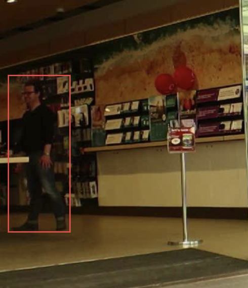
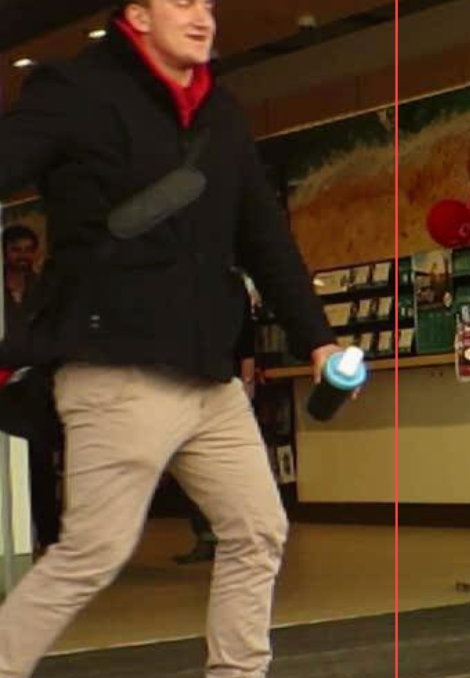
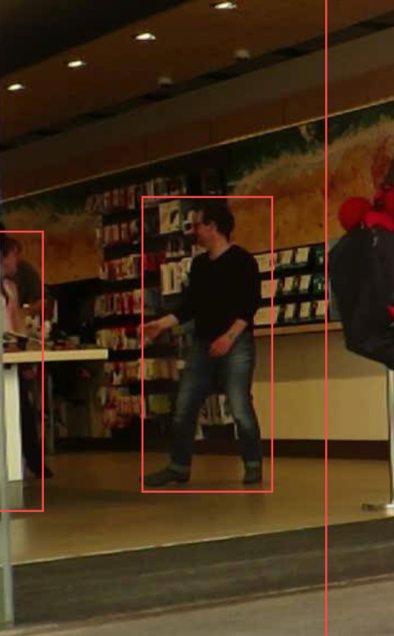

# Báo cáo cá nhân — HuynhNgocGiaHan-2A202603128

Đổi tên file theo quy tắc `MSSV_HoTen.md`. Ví dụ: `20241234_NguyenVanAn.md`.

Đoạn video: MOT17-09, 150 frame (frame 1–150), nguồn MOTChallenge, giấy phép CC BY-NC-SA 3.0.

## 0. Thông tin học viên

- Họ tên: Huỳnh Ngọc Gia Hân
- MSSV: 2A202603128
- Mã đề (A/B/C): C (P1–P5 = GT ID 1, 7, 20, 22, 23 của MOT17-09)
- Email: 26ai.hanhng@vinuni.edu.vn
- Link repository: https://github.com/suadaunanh/K5-L2-Day05-HuynhNgocGiaHan-2A202603128-MOTTracking
- Giờ bắt đầu: 16:30
- Giờ kết thúc: 17:30

## 1. Xem trước đoạn video (CP0)

Ghi **trước khi vẽ**, mỗi người một dòng.

| Mã | Frame xuất hiện | Frame cuối thấy được | Rẽ / dừng / đổi tốc độ ở frame | Bị che ở frame | Ghi chú |
|---|---|---|---|---|---|
| P1 | 0 | 149 | 0–60 đi sang phải trong cửa hàng; ~60–90 đứng gần quầy; ~90–149 đi chậm về phía camera | ~25–55 bị P5 đi ngang phía trước che một phần | Nam, áo len đen, quần jeans, đeo kính, ở **trong** Vodafone sau kính |
| P2 | ~40 (mờ sau kính) | 149 | ~62 đi ra khỏi cột kính, sang phải; ~90–149 đứng/đi chậm gần quầy | ~40–61 sau lớp kính + cột kính (P5 cũng đi ngang ~44–56) | Nữ, áo trắng–cam, quần đen, trong Vodafone. Đi ngang trước một ông có râu: dễ nhầm |
| P3 | 0 (bị cắt ở mép phải) | 149 | Đi thẳng về phía camera suốt đoạn, box to dần nhiều (nhất là ~100–149) | 0–~20 bị cắt ở mép khung; đi sát bà áo khoác xanh lá suốt đoạn | Nam, áo sơ mi xanh dương kẻ sọc, mũ trắng, quần nâu |
| P4 | 0 | ~105 | Gần như đứng yên trước cửa Woolworths 0–~100, dắt bé gái | ~98–105 bị bà áo xanh lá che dần; mất hẳn từ ~106 (bà áo xanh lá, P5, rồi P3 che) | Nữ, áo khoác jeans, túi hồng, cạnh bé gái áo trắng–xanh |
| P5 | 0 (bị cắt ở mép trái) | ~135 | 0–~40 đi sang phải, lại gần camera (box to); ~40–110 quay lưng, đi xa dần về phía Woolworths (box nhỏ dần) | ~110–119 bị bà áo xanh lá che một phần; mất hẳn ~120–126; hiện lại ~127–135 giữa bà áo xanh lá và P3; khuất sau P3 từ ~136 | Nam, áo khoác đen, khăn đỏ, quần kaki, ủng đen, cầm cốc xanh |

> Ghi chú: các mốc có dấu `~` là ước lượng khi xem lướt (bước 3–5 frame). Cần kiểm lại từng frame trên CVAT (`D`/`F`) trước khi đặt keyframe. Sau khi gán: P5 hiện lại ở frame 128 (xem mục 2).

## 2. Keyframe và thời gian (CP1, CP4)

Số keyframe lấy từ kết quả `src/check_submission.py`.

| Mã | Số keyframe | Keyframe ở frame | Số frame có mặt | Keyframe / 100 frame | Thời gian (phút) | Chỗ khó |
|---|---|---|---|---|---|---|
| P1 | 18 | 0, 10, 20, 27, 30, 52, 59, 60, 70, 80, 90, 93, 100, 109, 110, 120, 140, 149 (+ 39, 42 đặt outside) | 137 (0–38, 52–149) | 13,1 | | Ở trong cửa hàng sau kính; bị P5 đi ngang che một phần 30–38 và 52–58, khuất hẳn 39–51 |
| P2 | 15 | 40, 45, 50, 52, 60, 61, 70, 80, 90, 100, 110, 120, 130, 140, 149 | 110 (40–149) | 13,6 | | Mờ sau kính lúc mới xuất hiện; bị che 40–44 và 52–59; đi ra khỏi cột kính ~61, ngang qua ông có râu |
| P3 | 16 | 0, 10, 20, 30, …, 140, 149 (đều mỗi 10 frame) | 150 (0–149) | 10,7 | | Bị cắt ở mép phải lúc đầu; đi về phía camera nên box to dần |
| P4 | 12 | 0, 10, 20, …, 100, 103 (+ 109, 110 đặt outside) | 109 (0–108) | 11,0 | | Gần như đứng yên; bị bà áo xanh lá che 103–108 rồi mất từ 109 |
| P5 | 20 | 0, 10, 20, 30, 40, 50, 52, 60, 70, 80, 90, 100, 109, 110, 112, 113, 115, 119, 128, 130 (+ 120, 139, 140 đặt outside) | 131 (0–119, 128–138) | 15,3 | | Box to rồi nhỏ (lại gần rồi đi xa camera); khuất hẳn 120–127, hiện lại 128–138 |
| **Tổng** | 81 | | 637 | 12,7 | 60 | |

Số keyframe chỉ tính keyframe lúc người đó có mặt, không tính keyframe đặt outside. Đếm từ bản xuất CVAT lúc 12:14 UTC (19:14 giờ VN); đối chiếu lại với `src/check_submission.py`.

Keyframe / 100 frame của cả bài = tổng keyframe ÷ tổng số frame có mặt × 100 = 81 ÷ 637 × 100 ≈ **12,7**

Bạn đặt keyframe nhiều nhất ở người nào? Vì sao (người đó rẽ, dừng, lại gần camera hay bị che)?

Nhiều nhất là P5, cả về số lượng (20) lẫn mật độ (15,3 keyframe / 100 frame). P5 vừa đổi hướng, từ đi lại gần camera (box to dần) sang quay lưng đi xa (box nhỏ dần), vừa bị che rồi khuất hẳn 120–127 và hiện lại ở 128. Đoạn 109–119 ngay trước khi mất, P5 bị bà áo xanh lá che dần nên box thay đổi nhanh. Vì vậy em phải thêm keyframe dày ở 109, 110, 112, 113, 115, 119, rồi ở 128 và 130 khi P5 hiện lại. Đứng thứ hai là P1 (18 keyframe), vì bị P5 đi ngang che và khuất hẳn 39–51.

## 3. Đoạn bị che (CP2)

Người bị che: `P1` (bị P5 đi ngang phía trước che)

| Mốc | Frame |
|---|---:|
| Bắt đầu bị che một phần (bật `occluded`) | 30 |
| Mất hẳn (bật `outside`) | 39 |
| Hiện lại (tắt `outside`) | 52 |
| Thấy rõ trở lại (tắt `occluded`) | 59 |

- Thời gian khuất hẳn: 13 frame (39–51) = 13 ÷ 30 ≈ 0,43 giây.
- Quyết định: **giữ cùng ID**.
- Lý do (trả lời 3 câu: khuất bao lâu so với 60 frame, ngoại hình có khớp, chỗ hiện lại có đúng hướng và tốc độ):

  1. P1 chỉ khuất hẳn 13 frame (≈ 0,43 giây), ít hơn nhiều so với ngưỡng 60 frame (2 giây) của lớp.
  2. Ngoại hình khớp: vẫn là người nam áo len đen, quần jeans, đeo kính ở trong cửa hàng.
  3. P1 hiện lại ở frame 52 đúng chỗ dự đoán, ngay bên phải vị trí trước khi bị che, vẫn đi chậm sang phải như trước, không có người nào khác giống P1 ở gần đó.

Ảnh chụp màn hình:





## 4. Tự review ID (CP3)

Lượt 1 theo người (đi ngược từ frame 149 về 0 trên CVAT), lượt 2 theo cảnh (nhảy 10 frame). Ít nhất 3 dòng; không có lỗi thì ghi một dòng "đã kiểm hai lượt, không lỗi".

Loại lỗi dùng đúng một trong 7 mã: `id_switch`, `fragmentation`, `lost`, `merge`, `false_track`, `drift`, `flag`.

| Frame | Mã người | Loại lỗi | Mô tả một câu | Phát hiện ở lượt | Đã sửa? |
|---:|---|---|---|---|---|
| 128–138 | P5 | `fragmentation` | Sau khi khuất 120–127, P5 hiện lại dưới track mới thay vì nối vào track P5. | 1 | Đã sửa (gộp bằng Merge) |
| 129–138 | P5 | `false_track` | Có thêm một track thứ hai chồng lên cùng P5 (IoU tới 0,81), làm thừa một ID. | 2 | Đã sửa (xoá track thừa) |
| 103–108 | P4 | `flag` | P4 bị bà áo xanh lá che dần trước khi mất hẳn nhưng chưa bật `occluded`. | 1 | Đã sửa |
| 52–59 | P2 | `flag` | P2 bị P5 đi ngang che một phần nhưng chưa bật `occluded`. | 2 | Đã sửa |
| 110–119 | P5 | `flag` | P5 bị bà áo xanh lá che một phần nhưng chưa bật `occluded`. | 1 | Chưa |

Tổng hợp số lỗi theo loại:

| `id_switch` | `fragmentation` | `lost` | `merge` | `false_track` | `drift` | `flag` |
|---:|---:|---:|---:|---:|---:|---:|
| 0 | 1 | 0 | 0 | 1 | 0 | 3 |

Lỗi nào chỉ lượt 2 (theo cảnh) mới thấy, lượt 1 (theo người) không thấy? Vì sao?

Lỗi `false_track` ở P5 (và lỗi `flag` của P2 ở 52–59). Ở lượt 1, khi đi theo từng track, hai track của đoạn P5 hiện lại trông đều hợp lệ: đều là một box ngắn nằm đúng trên người. Chỉ khi xem cả cảnh trong cùng một frame (lượt 2) mới thấy hai box chồng gần khít lên cùng một người, tức là một người mang hai ID.

## 5. File xuất và kết quả tự kiểm (CP4)

| Kiểm tra | Kết quả |
|---|---|
| Tên file MOT 1.1 | `src/exports/HuynhNgocGiaHan_mot.zip` (`gt/gt.txt`, `gt/labels.txt`) |
| Tên file CVAT for video 1.1 | `src/exports/HuynhNgocGiaHan_cvat_video.zip` (`annotations.xml`) |
| Số track ID khác nhau trong `gt/gt.txt` (phải là 5) | 5 (ID 1 = P1, 2 = P3, 3 = P4, 4 = P5, 5 = P2) |
| Frame `outside` không có dòng trong `gt.txt` (đúng / sai) | Đúng. Ví dụ P1 (ID 1) không có dòng ở `frame_id` 40–52, P5 (ID 4) không có dòng ở `frame_id` 121–128 |
| Job đã completed trên CVAT máy cá nhân | |

Dán phần tóm tắt in ra từ `src/check_submission.py`:

```text
=== File MOT 1.1: HuynhNgocGiaHan_mot.zip ===
  Số track ID: 5   |   Tổng số box: 637
  [OK]        Đúng 5 track ID.

  Track | Frame có mặt | Số frame | Đoạn vắng (outside)
      1 |   0–149      |      137 | 39–51
      2 |   0–149      |      150 | -
      3 |   0–108      |      109 | -
      4 |   0–138      |      131 | 120–127
      5 |  40–149      |      110 | -

=== File CVAT for video 1.1: HuynhNgocGiaHan_cvat_video.zip ===
  Tổng: 81 keyframe / 637 frame có mặt = 12.7 keyframe / 100 frame
  [OK]        Đọc được 5 track từ annotations.xml.

=== Tóm tắt ===
  Lỗi: 0   |   Cảnh báo: 0
  Đạt. Dán phần tóm tắt này vào báo cáo mục 5.
```

## 6. Ba câu kết

1. Nếu được gán lại, bạn sẽ đặt keyframe khác ở đâu? Vì sao?

   Em sẽ bỏ các keyframe thừa của P2 ở frame 0–27, vì lúc đó P2 còn outside nên chúng không có tác dụng. Em cũng sẽ bớt kiểu "đều mỗi 10 frame" cho P4: P4 gần như đứng yên nên vài keyframe là đủ. Số keyframe tiết kiệm được em sẽ đặt ở những chỗ chuyển động thay đổi: P5 ở ~40 (đổi từ lại gần sang đi xa camera) và P3 ở ~100–149 (box to nhanh, hiện đang chỉ đặt đều mỗi 10 frame). Với P5 ở 109–119, em sẽ đặt keyframe theo đúng các frame bị che ngay từ đầu, thay vì đặt đều mỗi 10 frame rồi mới thêm vào sau khi thấy box trôi.

2. Có chỗ nào bạn không chắc "cùng ID hay ID mới"? Bạn đã quyết định và ghi chú thế nào?

   Có, đó là người hiện lại ở frame 128 giữa bà áo xanh lá và P3. Ngoại hình (áo khoác đen, quần kaki, ủng đen), vị trí và hướng đi đều khớp với P5. Thời gian khuất chỉ 8 frame, dưới 60 frame. Vì vậy em quyết định giữ cùng ID P5 và đã ghi chú ở CP0. Lúc đầu em lỡ tạo hai track mới cho đoạn này; khi tự review em đã gộp lại vào P5 bằng Merge và xoá track thừa.

3. Một lỗi ID trong job của bạn (nếu không còn sót, chọn lỗi đã sửa) có thể làm xe tự lái dự đoán sai chuyển động của người đó như thế nào? Lỗi đó ảnh hưởng MOTA hay IDF1 nhiều hơn?

   Với lỗi fragmentation của P5, khi P5 hiện lại dưới ID mới, hệ thống coi đó là một người vừa mới xuất hiện và không có lịch sử chuyển động. Nó không biết người này đang đi sang phải với tốc độ đều, nên dự đoán quỹ đạo kém hoặc phải chờ vài frame mới ước lượng được vận tốc. Trong lúc đó xe có thể phản ứng chậm nếu người này bước xuống đường. Lỗi này ảnh hưởng IDF1 nhiều hơn. IDF1 đo mức độ giữ đúng một ID trong suốt quỹ đạo, còn MOTA chỉ bị trừ một lần ID switch so với tổng số box nên gần như không thay đổi. Track thừa chồng lên P5 (nếu không xoá) thì làm tăng false positive, nên trừ cả MOTA lẫn IDF1.

## Bonus (nếu làm)

### B1 — Hai người đi sát

...

### B2 — So cách đặt keyframe

| Cách đặt | Số keyframe | Frame trôi nhất | Ghi chú |
|---|---:|---:|---|
| Đều mỗi 30 frame | | | |
| Theo chỗ đổi hướng | | | |

...

### B3 — So với tracker có sẵn

| Frame | Mã người | Tracker làm gì | Nhãn của bạn | Giải thích (đoán rồi sửa / ghép IoU / box score thấp / ngoại hình) |
|---:|---|---|---|---|
| | | | | |
| | | | | |

## 7. Tài liệu tham khảo và công cụ AI đã dùng

- MOT17 (MOTChallenge, Milan et al., 2016), CC BY-NC-SA 3.0.
- Tài liệu lớp: `RULES.md`, `docs/GUIDELINE.md`, `docs/MOT_FORMAT.md`, `docs/CVAT_CHEATSHEET.md`.
- Công cụ AI: Claude Code (Anthropic). Dùng để đối chiếu bảng nhận diện P1–P5 của đề C với `src/lab_variants.json`, điền phần thông tin hành chính, và lập bản nháp bảng xem trước (mục 1) từ ảnh frame; học viên đã kiểm lại các mốc trên CVAT. Claude (Cowork) còn đọc `annotations.xml` và `gt.txt` để đếm frame/track, phát hiện hai track trùng ở P5 và soạn bản nháp mục 3–6; học viên kiểm lại trên CVAT. AI không sinh box hoặc track ID.
