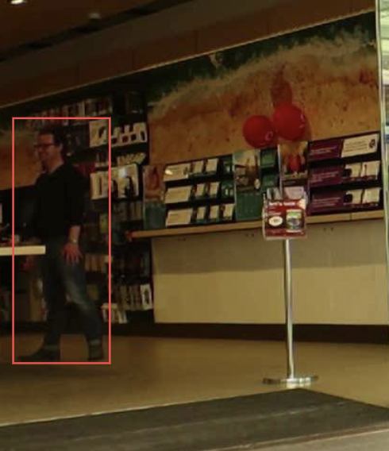
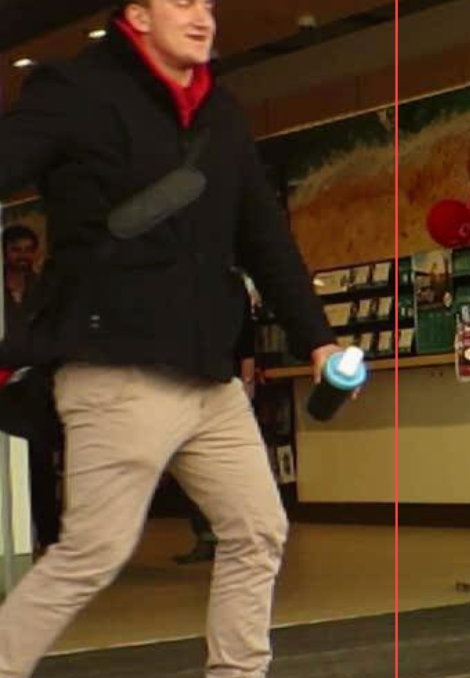
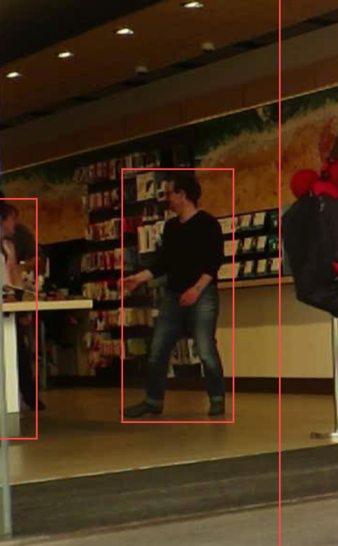

# Báo cáo cá nhân — HoVaTen-MSSV

Đổi tên file theo quy tắc `MSSV_HoTen.md`. Ví dụ: `20241234_NguyenVanAn.md`.

Đoạn video: MOT17-09, 150 frame (frame 1–150), nguồn MOTChallenge, giấy phép CC BY-NC-SA 3.0.

## 0. Thông tin học viên

- Họ tên: Huỳnh Ngọc Gia Hân 
- MSSV: 2A202603128
- Mã đề (A/B/C): de-C-P1-P5
- Email: 26ai.hanhng@vinuni.edu.vn
- Link repository: https://github.com/suadaunanh/K5-L2-Day05-HuynhNgocGiaHan-2A202603128-MOTTracking
- Giờ bắt đầu: 16h30
- Giờ kết thúc: 17h30

## 1. Xem trước đoạn video (CP0)

Ghi **trước khi vẽ**, mỗi người một dòng.

| Mã | Frame xuất hiện | Frame cuối thấy được | Rẽ / dừng / đổi tốc độ ở frame | Bị che ở frame | Ghi chú |
|---|---|---|---|---|---|
 P1 | 0 | 149 | 0–60 đi sang phải trong cửa hàng; ~60–90 đứng gần quầy; ~90–149 đi chậm về phía camera | ~25–55 bị P5 đi ngang phía trước che một phần | Nam, áo len đen, quần jeans, đeo kính, ở **trong** Vodafone sau kính |
| P2 | ~40 (mờ sau kính) | 149 | ~62 đi ra khỏi cột kính, sang phải; ~90–149 đứng/đi chậm gần quầy | ~40–61 sau lớp kính + cột kính (P5 cũng đi ngang ~44–56) | Nữ, áo trắng–cam, quần đen, trong Vodafone. Đi ngang trước một ông có râu: dễ nhầm |
| P3 | 0 (bị cắt ở mép phải) | 149 | Đi thẳng về phía camera suốt đoạn, box to dần nhiều (nhất là ~100–149) | 0–~20 bị cắt ở mép khung; đi sát bà áo khoác xanh lá suốt đoạn | Nam, áo sơ mi xanh dương kẻ sọc, mũ trắng, quần nâu |
| P4 | 0 | ~105 | Gần như đứng yên trước cửa Woolworths 0–~100, dắt bé gái | ~98–105 bị bà áo xanh lá che dần; mất hẳn từ ~106 (bà áo xanh lá, P5, rồi P3 che) | Nữ, áo khoác jeans, túi hồng, cạnh bé gái áo trắng–xanh |
| P5 | 0 (bị cắt ở mép trái) | ~135 | 0–~40 đi sang phải, lại gần camera (box to); ~40–110 quay lưng, đi xa dần về phía Woolworths (box nhỏ dần) | ~110–119 bị bà áo xanh lá che một phần; mất hẳn ~120–126; hiện lại ~127–135 giữa bà áo xanh lá và P3; khuất sau P3 từ ~136 | Nam, áo khoác đen, khăn đỏ, quần kaki, ủng đen, cầm cốc xanh |
> Ghi chú: các mốc có dấu `~` là ước lượng khi xem lướt (bước 3–5 frame). Cần kiểm lại từng frame trên CVAT (`D`/`F`) trước khi đặt keyframe. Riêng đoạn P5 hiện lại ~127–135 cần xác nhận đúng là P5 (quần kaki, ủng đen).


## 2. Keyframe và thời gian (CP1, CP4)

Số keyframe lấy từ kết quả `src/check_submission.py`.

| Mã | Số keyframe | Keyframe ở frame | Số frame có mặt | Keyframe / 100 frame | Thời gian (phút) | Chỗ khó |
|---|---|---|---|---|---|---|
| P1 | 15 | 0, 10, 20, 27, 30, 60, 70, 80, 90, 100, 109, 110, 120, 140, 149 | 150 | 10.0 | Ở trong cửa hàng sau kính; bị P5 đi ngang che 30–59 | 
| P2 | 14 | 40, 45, 50, 60, 61, 70, 80, 90, 100, 110, 120, 130, 140, 149 | 110 | 12.7 | | 	Mờ sau kính lúc mới xuất hiện; đi ra khỏi cột kính ~61, ngang qua ông có râu |
| P3 | 16| 0, 10, 20, 30, …, 140, 149 (đều mỗi 10 frame) | 150 | 10.7 | Bị cắt ở mép phải lúc đầu; đi về phía camera nên box to dần | 
| P4 | 11 (cập nhật sau khi thêm occluded) | 0, 10, 20, …, 100 (đều mỗi 10 frame) | 109 | 10.1 | Gần như đứng yên; bị bà áo xanh lá che dần rồi mất từ ~109 | 
| P5 | 12 (cập nhật sau khi gộp track 5, 6) | 0, 10, 20, …, 110 (đều mỗi 10 frame) | 120 | 10.0 | Box to rồi nhỏ (lại gần rồi đi xa camera); bị che ~110–129, hiện lại ~129–138 | 
| **Tổng** | 68 | | 639 | 10.6 | | |

Keyframe / 100 frame của cả bài = tổng keyframe ÷ tổng số frame có mặt × 100 = 68 ÷ 639 × 100 ≈ 10.6 (số tạm, tính trên bản xuất lúc 17:56, chưa tính 2 track thừa 5 và 6; cập nhật sau khi sửa P5)

Bạn đặt keyframe nhiều nhất ở người nào? Vì sao (người đó rẽ, dừng, lại gần camera hay bị che)?

Về số lượng, P3 có nhiều keyframe nhất (16) vì có mặt đủ 150 frame và đi thẳng về phía camera, box to dần liên tục. Về mật độ, P2 dày nhất (12.7 keyframe / 100 frame): ngoài keyframe đều mỗi 10 frame, phải thêm keyframe ở 45, 50, 61 vì P2 đi từ sau lớp kính ra, box đổi kích thước nhanh và bị cột kính che. Phần lớn keyframe vẫn đặt đều mỗi 10 frame, nên số keyframe giữa các người khá gần nhau.

## 3. Đoạn bị che (CP2)

Người bị che: `P_`

| Mốc | Frame |
|---|---:|
| Bắt đầu bị che một phần (bật `occluded`) | 110 |
| Mất hẳn (bật `outside`) | 120 |
| Hiện lại (tắt `outside`) | 129 |
| Thấy rõ trở lại (tắt `occluded`) | Không có, vì P5 hiện lại vẫn bị che một phần rồi khuất sau P3 (outside từ 139) |

- Thời gian khuất hẳn: 9 frame 120–128) = 0,3 giây (MOT17-09 quay 30 fps).
- Quyết định: giữ cùng ID 
- Lý do (trả lời 3 câu: khuất bao lâu so với 60 frame, ngoại hình có khớp, chỗ hiện lại có đúng hướng và tốc độ):
1. P5 khuất 9 frame, ngắn hơn nhiều so với ngưỡng 60 frame.
2. Ngoại hình khớp: áo khoác đen, quần kaki, ủng đen.
3. P5 hiện lại ở x ≈ 1330–1450, ngay sau vị trí cuối trước khi mất (x ≈ 1260–1415 ở frame 120). Hướng đi vẫn sang phải về phía Woolworths, tốc độ tương tự.
...

Ảnh chụp màn hình:





## 4. Tự review ID (CP3)

Lượt 1 theo người (đi ngược từ frame 149 về 0 trên CVAT), lượt 2 theo cảnh (nhảy 10 frame). Ít nhất 3 dòng; không có lỗi thì ghi một dòng "đã kiểm hai lượt, không lỗi".

Loại lỗi dùng đúng một trong 7 mã: `id_switch`, `fragmentation`, `lost`, `merge`, `false_track`, `drift`, `flag`.

| Frame | Mã người | Loại lỗi | Mô tả một câu | Phát hiện ở lượt | Đã sửa? |
|---:|---|---|---|---|---|
| 129–138 | P5 | fragmentation | Sau khi khuất 120–128, P5 hiện lại dưới track mới (CVAT 5, gt ID 7) thay vì nối vào track 4 | 1 | |
| | | | | | |
| | | | | | |

Tổng hợp số lỗi theo loại:

| `id_switch` | `fragmentation` | `lost` | `merge` | `false_track` | `drift` | `flag` |
|---:|---:|---:|---:|---:|---:|---:|
| | | | | | | |

Lỗi nào chỉ lượt 2 (theo cảnh) mới thấy, lượt 1 (theo người) không thấy? Vì sao?

...

## 5. File xuất và kết quả tự kiểm (CP4)

| Kiểm tra | Kết quả |
|---|---|
| Tên file MOT 1.1 | |
| Tên file CVAT for video 1.1 | |
| Số track ID khác nhau trong `gt/gt.txt` (phải là 5) | |
| Frame `outside` không có dòng trong `gt.txt` (đúng / sai) | |
| Job đã completed trên CVAT máy cá nhân | |

Dán phần tóm tắt in ra từ `src/check_submission.py`:

```text
...
```

## 6. Ba câu kết

1. Nếu được gán lại, bạn sẽ đặt keyframe khác ở đâu? Vì sao?

   ...

2. Có chỗ nào bạn không chắc "cùng ID hay ID mới"? Bạn đã quyết định và ghi chú thế nào?

   ...

3. Một lỗi ID trong job của bạn (nếu không còn sót, chọn lỗi đã sửa) có thể làm xe tự lái dự đoán sai chuyển động của người đó như thế nào? Lỗi đó ảnh hưởng MOTA hay IDF1 nhiều hơn?

   ...

## Bonus (nếu làm)

### B1 — Hai người đi sát

...

### B2 — So cách đặt keyframe

| Cách đặt | Số keyframe | Frame trôi nhất | Ghi chú |
|---|---:|---:|---|
| Đều mỗi 30 frame | | | |
| Theo chỗ đổi hướng | | | |

...

### B3 — So với tracker có sẵn

| Frame | Mã người | Tracker làm gì | Nhãn của bạn | Giải thích (đoán rồi sửa / ghép IoU / box score thấp / ngoại hình) |
|---:|---|---|---|---|
| | | | | |
| | | | | |

## 7. Tài liệu tham khảo và công cụ AI đã dùng

...
